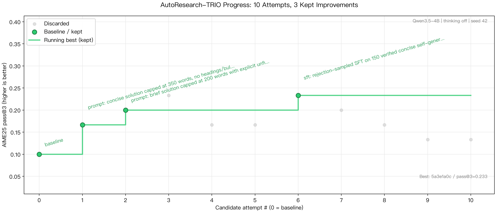

# AutoResearch-DemoCase



本轮记录：1 次基线 + 10 次候选尝试，保留 3 次改进；AIME25 pass@3 从 **0.100（3/30）** 到 **0.233（7/30）**。

一个用 PyTRIO 远程训练、SwanLab 记录实验的最小 AutoResearch 案例。目标是提升 **`Qwen/Qwen3.5-4B` 在 AIME25 上的 pass@3**，相对同一评测设置下的 4B 初始基线衡量进步。任何能修改文件、执行命令的 coding agent 都可以驱动实验。

coding agent 可以自主进行 **1 次基线 + 最多 10 轮候选尝试**。纯 Prompt 修改、GRPO、SFT 和 OPD 都可以探索；有改进就 commit，下一轮从该 commit 修改，未改进则恢复到当前最佳 commit。

## 文件分工

| 文件 | 作用 |
| --- | --- |
| [prepare.py](prepare.py) | 数据准备、训练预算、PyTRIO 训练接口与实验记录 |
| [evaluation.py](evaluation.py) | 固定的评测协议、答案评分、thinking 开关与并发评测；可独立运行 |
| [experiment.py](experiment.py) | coding agent 修改的 prompt 与训练配置 |
| [program.md](program.md) | 通用 coding agent 的实验规则与 SwanLab 分析流程 |

另外，[plot_progress.py](plot_progress.py) 从真实结果和决策记录生成实验进展图。[AGENTS.md](AGENTS.md) 提供 agent 的预算与 Git 规则。student 固定为 4B，OPD teacher 可从当前 PyTRIO 支持列表中选择兼容模型。

## 环境与数据准备

需要 Python 3.13+ 和 [uv](https://docs.astral.sh/uv/)。本机负责数据和训练循环，模型训练与采样由 PyTRIO 服务执行。

```bash
uv sync --locked
uv run python prepare.py prepare
uv run python prepare.py check
uv run python -m unittest discover -s tests -v
```

`prepare` 从固定 HF revision 下载完整原始数据，并校验 SHA256。文件保存在 `data/raw/dapo-math-17k.parquet` 与 `data/raw/aime25.jsonl`，来源、版本和校验值记录在 `data/raw/sources.json`。再次执行时复用已校验的本地文件。

程序分批扫描完整 DAPO-Math：移除原有回答格式指令，去重，过滤非整数答案和同题标准答案冲突的样本，排除与 AIME25 完全归一化匹配的题目。最后用固定 seed 选择 1024 道训练题，保存过滤计数和文件 SHA256。未做语义近重复审计。

已有原始 parquet 时可以复用，程序会验证它与固定版本的源文件 SHA256 一致：

```bash
uv run python prepare.py prepare --dapo-parquet /path/to/dapo-math-17k.parquet
```

数据和模型结果保存在被 Git 忽略的 `data/`、`runs/` 和 `swanlog/`，源码导入和 `check` 都不会连接模型服务。本地测试使用独立的模拟服务，验证预算、并发、评分和训练数据对齐。

## 训练与评测约定

| 项目 | 第一版配置 |
| --- | --- |
| 训练集 | [DAPO-Math-17k](https://huggingface.co/datasets/BytedTsinghua-SIA/DAPO-Math-17k) 的固定整数答案子集 |
| 优化与评测对象 | 固定 `Qwen/Qwen3.5-4B`，OPD teacher 可使用更大的兼容模型 |
| 训练方式 | 新建 LoRA；GRPO/OPD 用 `importance_sampling`，SFT 用 `cross_entropy` |
| 训练上限 | 每轮候选最多 20 个训练 round、20 次 `optim_step` |
| 每轮训练数据 | 4 道题；GRPO 每题 2–4 条、OPD 每题 1–4 条回答，SFT 每题一个监督目标 |
| 提示词实验 | 0 次权重更新，直接评测对应 prompt |
| 评测集 | [math-ai/aime25](https://huggingface.co/datasets/math-ai/aime25)，全部 30 题 |
| 评测 | 每题 3 条回答，每条最多 1024 输出 token，并发上限 16 道题 |
| 固定采样参数 | temperature 0.8、top-p 1.0、按题目设置固定 seed |
| 评测 thinking | `--eval-thinking` 开启，`--no-eval-thinking` 关闭；新实验默认关闭，同一比较中固定 |
| 模型交互 | 单轮文本，无工具调用；训练模板默认关闭 thinking |

`pass@3` 是三条回答至少有一条正确的题目比例；`average@3` 是全部 90 条回答的平均正确率。输出 token 上限包含模型生成的推理过程。另行记录格式率、达到长度上限的比例和停止原因；达到 1024 token 是长度上限指标，不直接等同于所有回答均被截断。

评测代码在 `evaluation.py` 的 `evaluate()` 中，训练候选自动调用同一份实现。thinking 开关传给 tokenizer 的 `apply_chat_template(enable_thinking=...)`，实际设置保存在 `result.json` 的 `protocol.enable_thinking` 和 SwanLab 配置中，`summary` 也会显示。该开关只控制评测；开启后仍共享 1024 输出 token 预算。基线与候选必须使用相同开关；如果比较两种 thinking 设置，分别建立对应基线。

GRPO 用同题回答的相对 reward 更新。OPD 用当前 student 采样，冻结 teacher 对同一条 student 轨迹计算逐 token logprob，再用 `-opd_kl_coef * (student_logprob - teacher_logprob)` 构造 advantage。OPD 的答案正确率只用于监控，损失信号来自 teacher。运行前检查双方 token vocabulary 的映射一致，保证 token ID 和 logprob 能对应。

SFT 默认监督 DAPO 的最终整数答案和 EOS，用于最小的答案/格式学习案例。训练解题过程时，把 `sft_data` 指向本地 JSONL；每行提供 `problem`、`answer` 和 `solution`，其中 `solution` 是 assistant 回复，最后的 boxed 答案须与标准答案一致。程序验证重复题、AIME25 重合和最终答案，记录数据 SHA256；这项检查未审计整段推理的数学正确性。

```json
{"problem": "What is 6 times 7?", "answer": "42", "solution": "6 times 7 is 42. \\boxed{42}"}
```

GRPO/OPD 每次更新前刷新 student sampler；无相对信号的组跳过，连续三个 batch 都没有有效组时提前停止。完整组的 advantage 算好后再拆 micro-batch，多个 backward 累积后只更新一次权重。SFT 只训练 assistant 目标 token，prompt 不进入 loss；所有方式共享 20 次权重更新上限。

每轮在同一个 4B 基础模型上新建 LoRA，不续训上一轮候选。改进可以来自提示词、GRPO、SFT 或 OPD，最终都评测 4B student；代码会拒绝将其他模型替换为评测对象。20 step 是更新次数上限，实际耗时取决于远程排队、推理和训练。1k 输出和小题集适合演示闭环，实际收益需要基线与重复测量确认。搜索过程中 AIME25 承担开发集的角色。

## Skills 与 SwanLab

项目明确允许 coding agent 使用：

- [pytrio-skill](https://github.com/SwanHubX/pytrio-skill)：核对接口、训练数据对齐与排查训练问题。
- [swanlab-skill](https://github.com/SwanHubX/SwanLab-Skill)：记录、查询、比较和可视化本项目实验。

如果 agent 环境还没有这两个 skill，可以按各仓库的安装说明配置。支持 Agent Skills 的工具可以使用以下全局安装方式：

```bash
npx skills add SwanHubX/pytrio-skill -g -y
npx skills add SwanHubX/SwanLab-Skill -g -y
```

SwanLab 默认使用 `offline` 模式，避免首次运行等待交互登录。已登录时可选择 `--swanlab-mode online`，把实验上传到私有项目。每个 run 都保存 SwanLab ID，在线模式另存 URL，并记录训练 reward、退化组比例、生成长度、trainer 指标和评测结果。[program.md](program.md) 包含指定指标的查询示例。

## 运行实验

先登录 PyTRIO；在线记录时也需登录 SwanLab：

```bash
uv run trio login
uv run swanlab login
uv run swanlab ping
uv run swanlab verify
```

在 `experiment.py` 中设置 `mode` 与 OPD 的 `teacher_base_model`，`base_model` 固定为 `Qwen/Qwen3.5-4B`。teacher 没有本地模型名称白名单；执行实验时查询当前账户的支持列表并检查 token 映射兼容性。`--teacher-base-model` 可以覆盖 teacher 配置，实际配置会写入结果。

只评测初始 prompt，作为基线：

```bash
uv run python evaluation.py --name baseline \
  --no-eval-thinking --swanlab-mode online
```

纯 Prompt 候选可以只修改 `experiment.py` 中的 `prompt` 和 `hypothesis`，使用 `mode="prompt"` 或传入 `--mode prompt`，不会调用训练接口。它与训练候选一样占用一轮尝试；评分提升后同样 commit。

也可以直接使用 `uv run python evaluation.py --name prompt-trial-01 --no-eval-thinking` 评测当前 prompt。`evaluation.py` 不带 `--run` 时评测 4B 基础模型，带 `--run` 时使用该 run 的 checkpoint 和 prompt；这两个入口都不更新权重。

运行 `experiment.py` 中的候选配置：

```bash
uv run python prepare.py run --name trial-01 \
  --no-eval-thinking --swanlab-mode online
```

例如使用 4B student 和 27B teacher 做 OPD：

```bash
uv run python prepare.py run --mode opd --name opd-4b \
  --no-eval-thinking \
  --teacher-base-model Qwen/Qwen3.8-27B --swanlab-mode online
```

OPD 的 `group_size` 可以设为 1；`teacher_model_path` 可以指定固定 teacher checkpoint，`opd_kl_coef` 控制蒸馏信号强度。使用 SFT 时设 `mode="sft"`，默认无需教师采样；带解题过程的数据通过 `sft_data` 指定。

要开启 evaluation thinking，把基线和所有候选命令中的 `--no-eval-thinking` 换成 `--eval-thinking`。可先用以下本地命令查看设置：

```bash
uv run python prepare.py check --eval-thinking
```

复测已有 checkpoint 与 prompt，不重新训练；默认继承原 run 的 thinking 设置，也可以显式传入开关：

```bash
uv run python evaluation.py --run runs/RUN_ID \
  --name confirm-01 --eval-seed 1042 --swanlab-mode online
uv run python prepare.py summary
```

每轮的 `runs/RUN_ID/` 包含 `experiment.py` 源码快照、`result.json` 配置/代码 hash/权重路径/SwanLab 信息、`metrics.jsonl` 和逐题 `generations.jsonl`。失败实验保留错误与已完成的数据，并标记为 `failed`，不生成完整评测分数。顶层 `results.jsonl` 汇总所有已结束的运行。

结果同时记录 `prepare_sha256` 和 `evaluation_sha256`，用于确认同一系列的训练工具与评测代码保持固定。原有 `prepare.py evaluate` 命令仍可使用。

## 交给 coding agent

每个系列先保存代码基线 commit，再做最多 10 次候选尝试，失败和未改进也计数。Prompt 优化和训练共享这 10 次预算，每个训练候选最多 20 step。

候选 pass@3 严格高于当前最佳且复测支持改进时，只提交本轮 `experiment.py`。下一轮从该 commit 修改；评分相同、下降或运行失败时，用 `git restore --source=BEST_COMMIT --staged --worktree -- experiment.py` 回退该文件。实验数据与日志继续保留，禁止用 `git reset --hard` 清理工作区。`decisions.jsonl` 记录每轮 run、父 commit、keep/discard/failed 和理由，`best.json` 指向最佳 run、commit 与 checkpoint，具体格式见 [program.md](program.md)。

可以这样给任意 coding agent 下指令：

> 阅读 program.md，开始 AutoResearch，目标是提升 Qwen3.5-4B 的 AIME25 pass@3。先跑一次基线，再自主尝试最多 10 轮，允许纯 Prompt 优化、GRPO、SFT 和 OPD。允许使用 pytrio-skill 和 swanlab-skill。每个训练候选最多 20 step，evaluation thinking 关闭，保持 1k 输出与固定并发评测协议。每次接受改进都 commit，下一轮基于该 commit 修改，无改进就回退到当前最佳 commit。记录所有决策，结束后生成进展图。不要 push。

## 不同 coding agent 使用不同分支

每个 agent 使用独立分支和 worktree（或独立 clone），分别维护自己的 `experiment.py`、10 次尝试预算、最佳 commit 与实验记录。`runs/`、`swanlog/`、`decisions.jsonl` 和 `best.json` 都在各自目录下；在同一个目录切换分支会保留这些被 Git 忽略的文件，因此并行实验需要独立目录。

例如，从项目根目录创建两个 worktree：

```bash
git worktree add -b research/agent-a ../AutoResearch-agent-a main
git worktree add -b research/agent-b ../AutoResearch-agent-b main
# 复用本地已准备的数据；研究期间保持数据不变
ln -s ../AutoResearch-DemoCase/data ../AutoResearch-agent-a/data
ln -s ../AutoResearch-DemoCase/data ../AutoResearch-agent-b/data
```

在各 worktree 中运行 `uv sync --locked` 和 `uv run python prepare.py check`，再交给对应 agent。各 agent 保留分支内的改进 commit；比较结果时使用相同 thinking、采样参数和数据版本。

## 实验进展图

```bash
uv run python plot_progress.py --output runs/progress.png
# 也可以显式选择一个实验系列的基线
uv run python plot_progress.py --baseline BASELINE_RUN_ID --output runs/progress.png
```

默认从 `best.json` 读取 `baseline_run_id`，再读取该系列的 `decisions.jsonl` 与 `runs/*/result.json`。输出 PNG、SVG 和可核对的绘图数据 JSON：灰点表示未保留候选，绿点表示基线与已保留改进，绿色阶梯线表示当前最佳，失败尝试用图底部的红色叉号标记。标注包含实验方式和改进理由，右下角显示最佳 commit 与 pass@3。

绘图只使用本地真实记录，复测不会额外算作候选点。程序检查候选预算、评测协议、数据版本、Git 父 commit 和评分有效性；没有实验记录时提示先提供基线。

参考：[karpathy/autoresearch](https://github.com/karpathy/autoresearch)、[agentic-rl-lab/05-retool](https://github.com/KMnO4-zx/agentic-rl-lab/tree/main/05-retool)、[PyTRIO 文档](https://docs.pytrio.com/docs)。
